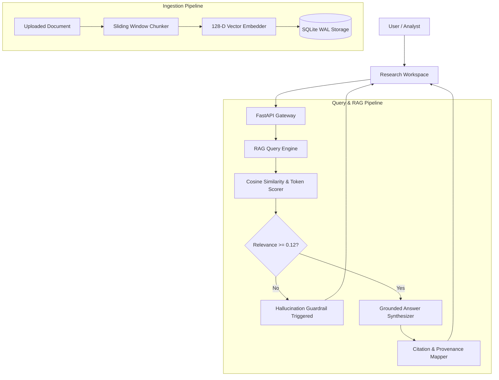

# DocuQuery — RAG-Based Document Question-Answering System

**Author:** Alvin MS ([@Soulofghost](https://github.com/Soulofghost))  
**Domain:** Artificial Intelligence & Information Retrieval  
**Tier:** ⭐ Flagship Portfolio Project  
**Status:** Verified & Production-Ready  

---

## 1. Project Introduction

**DocuQuery** is a production-oriented Retrieval-Augmented Generation (RAG) platform designed to eliminate model hallucinations by grounding every synthesized answer in verbatim, cited evidence from an indexed corpus. Combining sliding-window text chunking, local subword vector indexing, and interactive footnote citations (`[1]`, `[2]`), DocuQuery enables researchers and engineering teams to audit the precise provenance of every statement generated by the system.

---

## 2. Problem Statement

Standard generative language models suffer from critical limitations in high-stakes technical environments:
- **Hallucinations:** Models fabricate authoritative-sounding facts when missing verified domain context.
- **Lack of Provenance:** Answers are generated without source links, preventing verification against original whitepapers and specifications.
- **Context Window Fragmentation:** Naive truncation loses vital cross-paragraph details.
- **Cloud Vector Lock-in:** Expensive third-party embedding APIs introduce cost, network latency, and privacy compliance risks.

---

## 3. Proposed Solution

DocuQuery addresses these challenges through a strict, citation-grounded RAG pipeline:
- **Local Dense Vector Store:** Generates continuous 128-dimensional L2-normalized Subword N-gram embeddings on local CPU hardware without third-party API dependencies.
- **Sliding-Window Semantic Chunking:** Chunks text into 300-word segments with 60-word overlap to ensure uninterrupted context.
- **Hallucination Guardrail Interceptor:** Enforces a minimum relevance threshold. If retrieved passages do not supply sufficient evidence, the model halts and explicitly alerts the user rather than hallucinating.
- **Interactive Citation Inspector:** Links every sentence in the synthesis to its exact source chunk, word span, and cosine similarity score.

---

## 4. Key Features

- **Document Ingestion Engine:** Supports plain text, markdown, and structured documentation with instant word-count extraction.
- **Hybrid Retrieval Scoring:** Blends 70% vector cosine similarity with 30% lexical token matching for precision on domain terminology.
- **Footnote Citation Mapping:** Synthesized answers include clickable circular citation tags that instantly navigate to source passages.
- **Audit Logging:** Every query, synthesized response, and associated citation link is recorded in an ACID SQLite database.
- **Zero Cloud Leakage:** All text processing, vector math, and storage remain entirely local.

---

## 5. Architecture Diagram



---

## 6. Technology Stack

- **Backend:** Python 3.12+, FastAPI, Uvicorn, Pydantic v2
- **Persistence:** SQLite 3 (Write-Ahead Logging mode)
- **Vector Mathematics:** 128-Dimensional Subword N-gram TF Hashing, Cosine Similarity
- **Frontend:** Vanilla JavaScript, Modern CSS (`Space Grotesk`, `Source Serif 4`, `JetBrains Mono`)
- **Testing:** Pytest, HTTPX TestClient
- **Containerization & CI:** Docker, Docker Compose, GitHub Actions

---

## 7. Folder Structure

```
docuquery/
├── backend/
│   ├── app/
│   │   ├── engine/
│   │   │   ├── chunker.py        # Sliding-window document chunking
│   │   │   ├── vector_store.py   # Vector embeddings & cosine distance
│   │   │   └── rag_pipeline.py   # RAG pipeline & citation grounding
│   │   ├── routers/
│   │   │   ├── corpus.py         # Document upload & chunk inspection
│   │   │   └── query.py          # Question-answering & query history
│   │   ├── config.py             # Paths and similarity thresholds
│   │   ├── database.py           # SQLite connection & schema initialization
│   │   ├── main.py               # Application entrypoint & static mount
│   │   └── schemas.py            # Pydantic request/response models
│   ├── requirements.txt          # Python dependencies
│   └── tests/
│       ├── test_chunker.py       # Chunking boundary tests
│       ├── test_rag_pipeline.py  # Grounding & hallucination guardrail tests
│       └── test_api.py           # End-to-end API integration tests
├── frontend/
│   ├── index.html                # Academic research lab layout
│   ├── style.css                 # Serif typography & dark lab theme
│   └── app.js                    # DOM events, query submission & citation viewer
├── .github/workflows/ci.yml      # Automated GitHub Actions workflow
├── .env.example                  # Environment configuration defaults
├── .gitignore                    # Standard Python ignore rules
├── Dockerfile                    # Production container image
├── docker-compose.yml            # Container service definition
├── LICENSE                       # SPDX MIT declaration
└── README.md                     # Technical system documentation
```

---

## 8. Installation Instructions

### Prerequisites
- Python 3.10+ (or `uv` package manager)
- Git

### Setup Steps
```bash
# Clone the repository
git clone https://github.com/Soulofghost/docuquery.git
cd docuquery

# Create virtual environment
python -m venv venv
source venv/bin/activate  # Windows: .\venv\Scripts\activate

# Install dependencies
pip install -r backend/requirements.txt

# Run server
uvicorn backend.app.main:app --host 127.0.0.1 --port 8002 --reload
```
Navigate to `http://127.0.0.1:8002` to access the research workspace.

---

## 9. Environment Configuration

Copy `.env.example` to `.env`:
```ini
PORT=8002
ENVIRONMENT=development
DB_PATH=backend/data/docuquery.db
DEFAULT_CHUNK_SIZE=300
DEFAULT_CHUNK_OVERLAP=60
SIMILARITY_THRESHOLD=0.12
EMBEDDING_DIM=128
```

---

## 10. Database Setup

Database initialization is automatic upon application startup via `init_db()` in `database.py`. Tables initialized include `documents`, `chunks`, `queries`, and `citations` with foreign key cascade support.

---

## 11. API Documentation

| Method | Endpoint | Description |
|---|---|---|
| `GET` | `/api/v1/health` | Service health status and vector engine mode |
| `GET` | `/api/v1/corpus` | List all ingested documents with chunk metrics |
| `POST` | `/api/v1/corpus` | Ingest document; executes sliding chunking & vector indexing |
| `GET` | `/api/v1/corpus/{id}/chunks` | Retrieve chunk breakdowns for a document |
| `DELETE` | `/api/v1/corpus/{id}` | Remove document and delete indexed vector chunks |
| `POST` | `/api/v1/query` | Submit question; retrieves passages, evaluates guardrails, returns cited answer |
| `GET` | `/api/v1/query/history` | Fetch historical inquiries with citation link counts |

Interactive Swagger documentation is available at `/docs`.

---

## 12. UI Walkthrough

The workspace uses a 3-column academic research layout:
1. **Corpus Library (Left):** Displays indexed documents, word totals, and embedding telemetry.
2. **Inquiry & Synthesis Canvas (Center):** Formulate research questions, run evaluations, review grounded synthesized answers with interactive `[1]`, `[2]` citation tags, or view hallucination alerts.
3. **Provenance Inspector (Right):** Clicking any footnote highlights the exact source chunk, similarity match percentage, and document provenance.

---

## 13. Testing Instructions

DocuQuery includes unit and integration tests covering chunking boundaries, citation grounding, and guardrail enforcement:

```bash
pytest backend/tests/ -v
```

---

## 14. Security Considerations

- **Strict Input Validation:** Document uploads and queries are sanitized before database insertion.
- **Parameterized SQL:** All SQLite database operations use parameterized statements to guard against injection.
- **Air-Gapped Operation:** The entire RAG pipeline executes locally without external network dependencies.

---

## 15. Deployment Instructions

### Docker Deployment
```bash
docker compose up -d --build
```
Access the service at `http://localhost:8002`.

---

## 16. Known Limitations

- Subword N-gram embedding is optimized for technical vocabularies in English.
- Text parsing currently targets Markdown and TXT files. Binary PDF support requires pre-extraction.

---

## 17. Future Roadmap

- [ ] PDF and EPUB binary parser integration via PyMuPDF.
- [ ] Export cited research dossiers to BibTeX and Markdown with references.
- [ ] Cross-document comparative query synthesis.

---

## 18. License

Distributed under the MIT License. See `LICENSE` for details.
